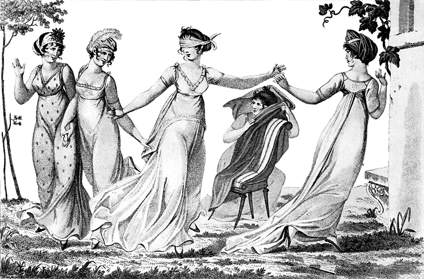
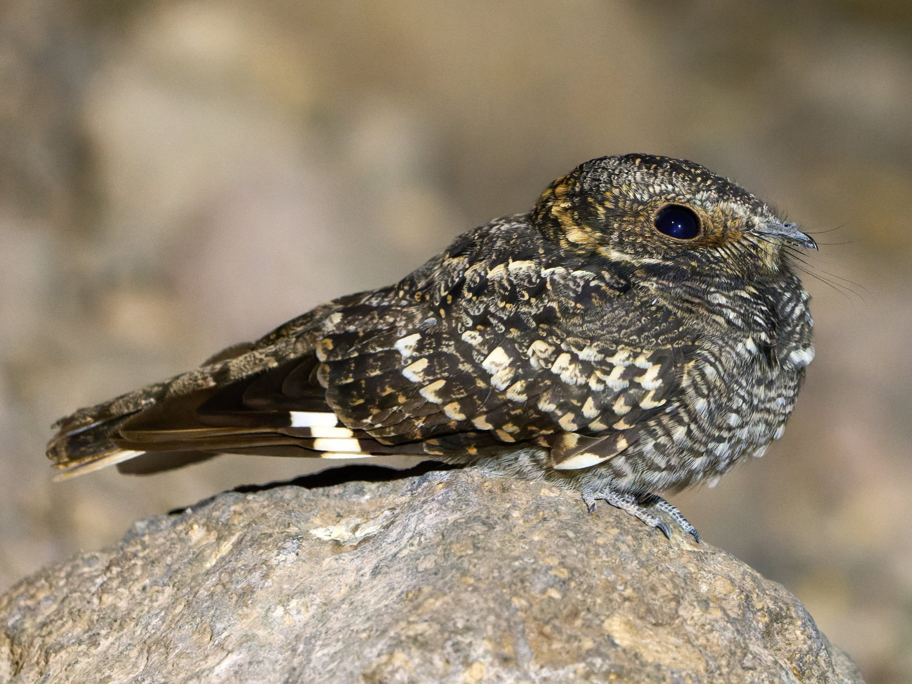

这个话要从“瞎子摸人”这个游戏说起。这个游戏在西班牙语里叫 Gallita Ciega, “瞎鸡仔”，也正常吧。

但今天的主题是一种在智利被叫做“瞎鸡仔”的鸟。

 

西班牙人去了南美，发现这个在大白天你靠近它的时候它就眯着眼不动也不躲，就像在玩“瞎子摸人”这个游戏，于是就把它叫做“瞎鸡仔”了。这种鸟昼伏夜出，喜欢在路灯下捉趋光的飞虫，而白天它会利用保护色坐在某个地方一动不动躲避敌害，但不知道为啥总被人们发现它坐在显眼的地方，估计是有点儿傻哈哈。

我找到了一个视频：https://www.youtube.com/watch?v=9_oB0zV_e70
​
​这种鸟英语叫 Band-winged Nightjar，翻译过来就叫“翅膀有一条斑的夜鹰”吧。夜鹰这个名字来自于同属的另一个代表性物种 Night Hawk，尽管这个名字极其不符合实际——它不是鹰，它的活跃时间是晨昏而不是夜晚——中文还是把“夜鹰”用作了属名，而习惯性的种名也大多翻译成了“某某夜鹰”。

实际上物种取名向来都是乱七八糟，人们应该已经见怪不怪了。

至于英语叫它 Nightjar，是因为它会在夜里发出吵人的叫声，要我说不如叫它“夜喳”算了。